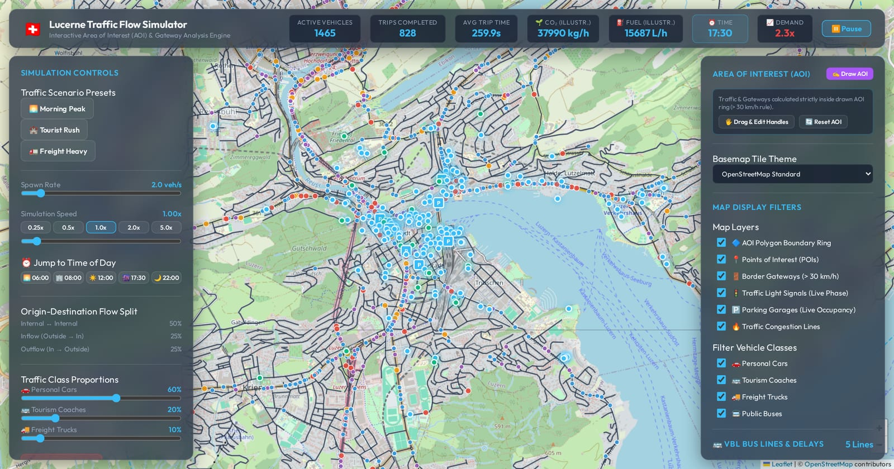

# Lucerne Traffic Flow Simulator

An abandoned experiment: a browser-based traffic simulation of Lucerne, written entirely by AI coding agents, that looks convincing but is not a valid traffic model.



<!-- TODO: add the link to the note on dbernet.ch once it is published:
     https://dbernet.ch/notes/vibe-coded-traffic-simulation/ -->

## What and why

One Sunday evening the drive back into Lucerne was frustratingly congested, with no obvious
reason. I wanted to know why, and I asked myself a second question: could I just throw compute
and AI coding agents at the problem and find out?

My part was the idea, the direction, the research and evaluating the results. I didn't write
the code. The whole application was vibe-coded by AI coding agents, including the bug fixes in
[PR #1](https://github.com/daniel-bernet/traffic-flow-simulator/pull/1) and the clean-up for
publishing.

What it does:

- Downloads the drivable road network of Lucerne and ten surrounding municipalities from
  OpenStreetMap (about 4,200 nodes and 9,150 directed road segments).
- Lets you draw a study area on the map. Roads faster than 30 km/h that cross its boundary
  become gateways where traffic enters and leaves.
- Spawns cars, coaches, trucks and buses with a gravity-style destination choice, moves them
  with the Intelligent Driver Model, and streams their positions to a Leaflet map over
  WebSockets.
- Lets you close roads, retune 25 traffic signals, jump to a time of day and follow five
  simplified bus lines and how late they run.

## Result

No, it couldn't answer the question. It produced a convincing-looking interactive sandbox, not
a valid model.

The clearest evidence came from measuring it. Several features looked right on screen but
didn't work until they were checked with numbers (PR #1): closed roads didn't stop traffic
because vehicles teleported across them, about 23 % of requested trips vanished without being
counted, and every vehicle drove in lane 0 because lane assignment never ran.

The lesson I take from it: AI coding agents make it fast to build something that looks like a
simulation. Turning it into a valid model needs domain knowledge, real data and validation,
and the agents didn't supply any of those.

## Limitations

The main reasons it can't explain a real traffic jam (details in
[docs/TRAFFIC_SIMULATION_MODEL.md](docs/TRAFFIC_SIMULATION_MODEL.md)):

- **No congestion feedback.** Vehicles pick the fastest route for empty roads when they start
  and never change it because of traffic. The congestion formula (BPR) only colours the map.
- **Dimensionally incorrect V/C ratio.** It divides the number of vehicles on a segment by a
  share of its hourly capacity, so long segments look congested at normal densities.
- **No queue spillback.** Vehicles only react to the vehicle ahead on the same segment, so a
  queue never backs up through a junction.
- **Uncontrolled junctions.** Apart from 25 hand-placed signals, about 2,000 junctions have no
  control; vehicles pass through without yielding.
- **Uncalibrated clock.** "1.0x" runs roughly three to four times faster than real time and
  varies with machine load.
- **Random land use.** Homes and workplaces are a random 60/40 split of all network nodes.
- **Synthetic weekday demand.** One time-of-day curve for every day; there is no Sunday.
- **Placeholder data.** The bus lines, signal locations, parking garages, gateway weights and
  the time-of-day curve are unverified values from quick web searches, not from official data.
- The CO₂ and fuel figures in the header are illustrative only and far too high.
- Network counts vary with the OpenStreetMap snapshot; every rebuild downloads current data.

## Status

Abandoned. There will be no further development: I don't have the domain knowledge or the
data it would need, and my interest and time went elsewhere.

## How to run

Requires Python 3 (tested with 3.12) on Linux or macOS, and an internet connection for the
first start.

```bash
git clone https://github.com/daniel-bernet/traffic-flow-simulator.git
cd traffic-flow-simulator
./run.sh
```

`run.sh` creates a virtual environment, installs the dependencies, downloads and caches the
road network (3–6 minutes the first time) and serves the app at http://localhost:8000. If
OpenStreetMap's Overpass API is busy, the download is retried and then stops with an error;
run `python -m src.data_loader --rebuild` later to try again.

Tests (after the first start, which builds the network cache):

```bash
source .venv/bin/activate
python -m unittest
```

## Documentation

- [Simulation model](docs/TRAFFIC_SIMULATION_MODEL.md): what the engine computes and where it falls short
- [Study area and gateways](docs/GATEWAY_SPECIFICATION.md)
- [API and user interface](docs/API_AND_GUI_GUIDE.md)
- [Data sources (research notes, not implemented)](docs/DATA_SOURCES_FUTURE_WORK.md)
- [Data files and OpenStreetMap attribution](data/README.md)

## Licence

- Code: [MIT](LICENSE), © 2026 Daniel Bernet.
- Documentation: [CC BY 4.0](LICENSE-docs.md), © 2026 Daniel Bernet.
- `data/gateways.json` is derived from OpenStreetMap data and available under the
  [ODbL 1.0](https://opendatacommons.org/licenses/odbl/1-0/).

## Credits

- Road network and map data © [OpenStreetMap contributors](https://www.openstreetmap.org/copyright), ODbL 1.0, downloaded with [OSMnx](https://github.com/gboeing/osmnx).
- Map tiles: OpenStreetMap Standard © OpenStreetMap contributors (used in the screenshot); Esri World Dark Gray Canvas, powered by Esri.
- Libraries: [NetworkX](https://networkx.org), [Shapely](https://shapely.readthedocs.io), [GeoPandas](https://geopandas.org), [FastAPI](https://fastapi.tiangolo.com), [Uvicorn](https://www.uvicorn.org), [Leaflet](https://leafletjs.com) (loaded from unpkg), the [Outfit](https://fonts.google.com/specimen/Outfit) font (loaded from Google Fonts).
- Traffic models: the Intelligent Driver Model (Treiber, Hennecke and Helbing, 2000) and the Bureau of Public Roads volume-delay function.
